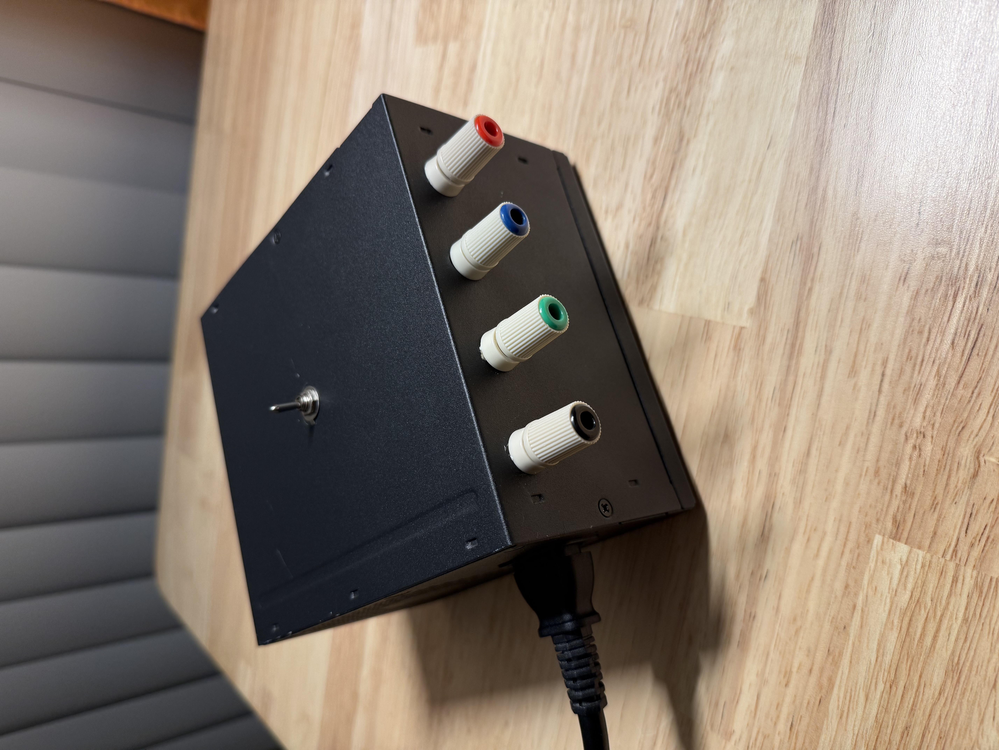
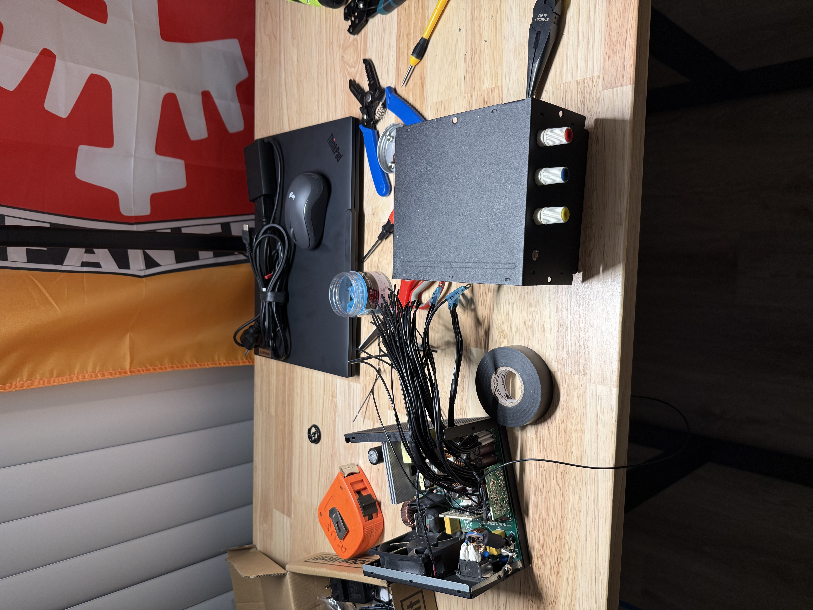
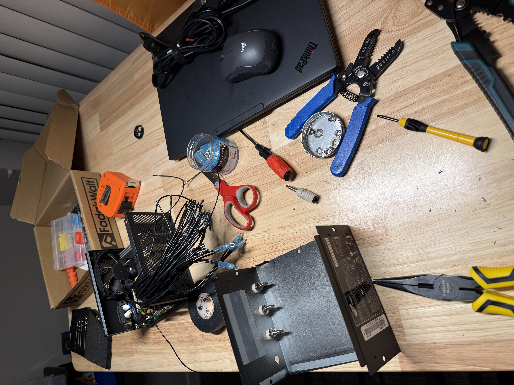
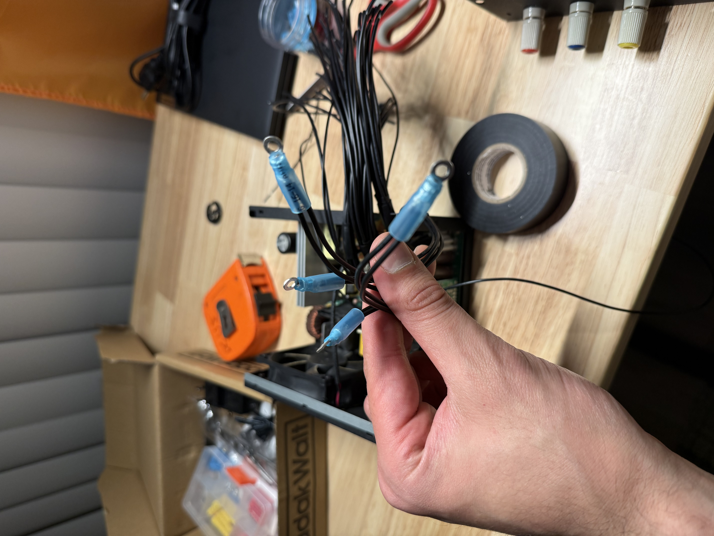
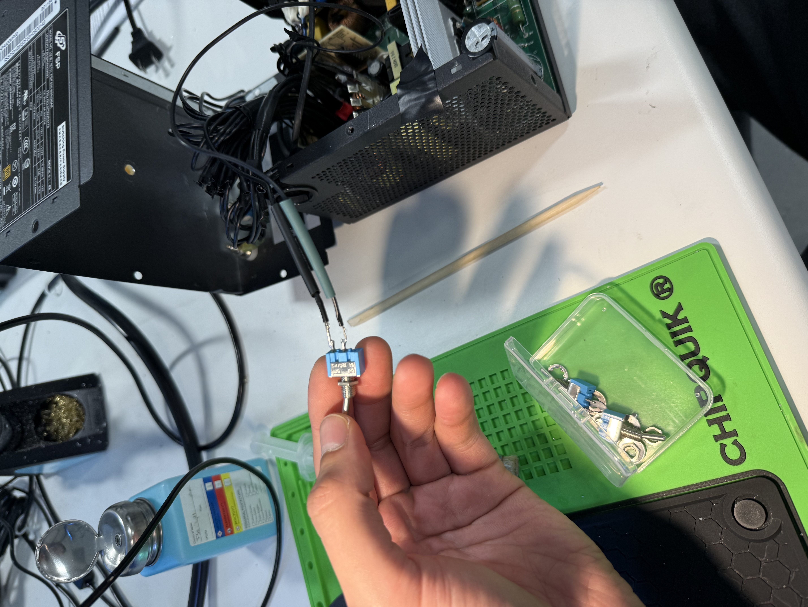

# PC PSU to Benchtop Power Supply

> Converted a standard ATX computer power supply into a reliable, switch-controlled benchtop power supply for electronics prototyping and lab work.

## Overview
* **Status:** Completed
* **Core Technology:** ATX Power Supply, Wiring Harness, Soldering, SPST Switch, Terminal Connectors
* **Primary Objective:** Repurpose computer hardware into a stable multi-voltage bench power source with custom safety switches and output terminals.

---

## Build Process & Hardware
* **Teardown & Prep:** Stripped down the ATX unit, mapped out internal rails, and planned layout.
* **Component Assembly:** Integrated binding posts, added custom wire crimping, and installed a dedicated manual power switch.

---

## Build Gallery
| Preparation & Layout | Components & Wiring | Crimping Process |
| :---: | :---: | :---: |
|  |  |  |

| Switch Installation | Hero Shot |
| :---: | :---: |
|  |  |

---

## Future Improvements / Next Steps
- [ ] Add a digital dispaly for Voltage/Amp/Power.
- [ ] Document pinout reference and maximum current ratings per rail (+3.3V, +5V, +12V).
